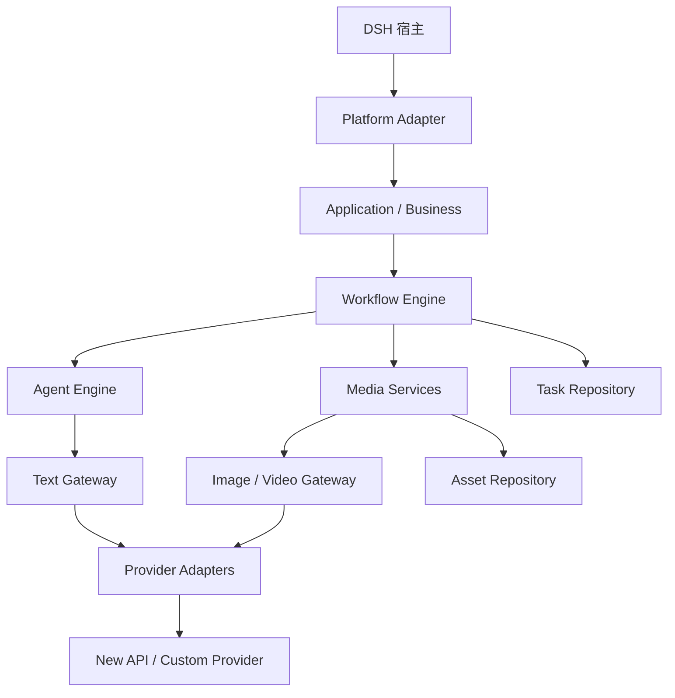
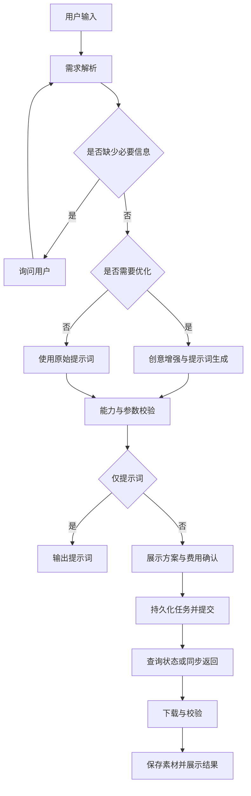

# MetaOntic Media V1.0 技术与产品设计方案

> 项目：`dsh-metaontic-media` | 版本：V1.0 | 状态：设计基线
> 宿主：DeepSeek Harness（DSH） | 技术：TypeScript / JavaScript

## 1. 产品定位与目标

让创意成为作品（Turn Ideas into Media）。面向普通创作者、自媒体和电商用户，提供自然语言驱动的图片、视频生成能力。插件不绑定模型服务商，MetaOntic AI / New API 为可选接入渠道。第一版以单次图片或视频生成闭环为目标，不建设完整影视生产平台。

### 1.1 范围

| 模块 | V1.0 范围 | 优先级 |
|---|---|---|
| 图片 | 文生图、参考图生成、图片编辑（模型支持时） | P0 |
| 视频 | 文生视频、图生视频、首尾帧（模型支持时） | P0 |
| 创作 | 需求解析、创意增强、图片/视频提示词 | P0 |
| 模型 | 自定义服务地址、密钥、模型能力配置 | P0 |
| 任务 | 提交、查询、恢复、下载、失败处理 | P0 |
| 素材 | 本地文件、参考图、生成结果、历史记录 | P0 |
| 用量 | 文本 token、媒体调用次数、已知费用 | P1 |

V1 不实现长片自动剪辑、复杂多 Agent 自主协商、音频生成、云端多租户、批量营销、独立 Web 服务。保留扩展接口。视频时长、画幅、分辨率均由模型能力决定。

## 2. 用户交互与功能需求

用户可以直接输入“生成一段15秒的乡村搞笑视频，两个老人讨论退休金，16:9”，也可以输入图片路径并要求图生视频。系统解析需求，展示创作方案、模型、参数及可获得的费用信息，确认后执行。用户明确要求直接生成时可跳过创意增强，但默认仍需确认付费操作。提示词模式不调用媒体模型。

| 建议命令（逻辑名称） | 功能 |
|---|---|
| `/media` | 帮助与入口 |
| `/media image` | 图片创作 |
| `/media video` | 视频创作 |
| `/media prompt` | 仅生成提示词 |
| `/media models` | 模型列表及能力 |
| `/media config` | 配置及连接测试 |
| `/media tasks` | 历史任务 |
| `/media status <id>` | 查询与恢复任务 |
| `/media retry <id>` | 安全重试 |
| `/media cancel <id>` | 取消（支持时） |
| `/media assets` | 素材列表 |

上述为拟定命令，不是已验证的 DSH API；实际注册方式以宿主 SDK 为准。交互优先使用宿主原生能力，不额外开发独立 UI。

## 3. 总体架构



依赖方向：宿主适配 → 应用业务 → 工作流及领域服务 → 接口抽象；具体 HTTP、存储实现通过依赖注入装配。Agent 只生成结构化内容，不执行付费媒体调用。工作流负责确认、预算校验、执行与恢复。V1 使用确定性顺序编排，不引入重量级 DAG 框架。

## 4. 代码目录

```text
dsh-metaontic-media/
├── package.json
├── tsconfig.json
├── README.md
├── docs/
├── src/
│   ├── index.ts
│   ├── app/                 # bootstrap, container, registry
│   ├── agents/
│   │   ├── core/            # runner, schema, context
│   │   ├── intent/
│   │   ├── creative/
│   │   ├── image-prompt/
│   │   └── video-prompt/
│   ├── businesses/
│   │   ├── image/
│   │   ├── video/
│   │   └── prompt/
│   ├── workflows/           # engine, definitions, checkpoint
│   ├── models/
│   │   ├── gateway.ts
│   │   ├── capabilities.ts
│   │   ├── registry.ts
│   │   └── adapters/        # openai-image, newapi-video, custom
│   ├── services/            # task, asset, config, usage
│   ├── media/               # file validation, download, metadata
│   ├── storage/             # repositories, atomic-json, lock
│   ├── platform/dsh/        # commands, tools, lifecycle, UI bridge
│   ├── shared/              # errors, logger, http, ids
│   ├── ui/                  # host presentation models
│   ├── locale/              # zh-CN, en-US
│   └── types/
└── tests/                   # unit, integration, fixtures, e2e
```

每个 Agent 目录包含 `agent.ts`、`system-prompt.ts`、`schema.ts`、`index.ts`。采用 TypeScript strict 模式，构建产物为 JavaScript；模块格式、Node 版本、插件 manifest 及发布入口需依据实际 DSH SDK 确定。

## 5. 工作流设计



图片同步返回和视频异步返回均转换为统一任务对象。模型不支持指定能力时，给出可选参数，不静默降级。确认后请求参数发生变化必须重新确认。每个工作流节点保存输入、输出、状态与 promptVersion，恢复时跳过已成功节点。用户取消确认时不发起媒体请求。

## 6. Agent 设计与完整系统提示词

所有 Agent 使用结构化 JSON 输出，运行器进行 schema 校验；解析失败允许一次修复，不无限重试。用户输入与参考素材描述均作为数据，不得覆盖系统约束。文本模型使用宿主提供的能力或显式配置的文本 Provider。

### 6.1 IntentAgent

```text
你是 MetaOntic Media 的多媒体需求分析师。你的任务是把用户的自然语言转换为可执行的创作需求，不生成媒体，不调用工具。
识别目标：图片、视频或仅提示词；识别生成模式、主题、人物、场景、动作、对白、视觉风格、画幅、时长、分辨率、参考素材、模型偏好、是否优化。
严格保留用户明确指定的事实、人物、对白和限制。不要虚构文件路径、模型能力、商品功效或用户未提供的事实。
必要信息缺失且无法安全推断时写入 questions；非必要信息可以采用合理默认值并记录 assumptions。不要把建议当作用户确认。
输出合法 JSON，不使用 Markdown，不输出解释性文字：
{"mediaType":"image|video","action":"generate|prompt","mode":"text|image|edit|first-last-frame","idea":"","subjects":[],"dialogue":[],"style":null,"aspectRatio":null,"duration":null,"resolution":null,"references":[],"model":null,"optimize":true,"constraints":[],"questions":[],"assumptions":[]}
```

### 6.2 CreativeAgent

```text
你是 MetaOntic Media 的创意策划与编剧。根据结构化需求完善创意，使作品具有明确主题、可见动作、内容层次和视觉吸引力。
尊重用户指定人物、对白、主题和时长，不擅自改变核心立意。短视频优先采用开场吸引、内容发展、结尾落点；根据题材选择适合的节奏，不强制所有视频反转。图片强调主体、构图、环境和视觉重点。
补充必要的细节，不引入无关人物，不使用无法视觉化的抽象描述。对白应符合人物身份、自然口语和实际时长；若原对白过长，保留原文并提出精简建议，不擅自替换。
商品类内容不得编造功效、销量、认证或价格。参考图中的主体特征应保持一致。不要声称已生成素材。
只输出 JSON：{"title":"","concept":"","subjects":[],"setting":"","beats":[{"start":0,"end":0,"visual":"","action":"","dialogue":""}],"visualStyle":"","audio":"","constraints":[],"warnings":[]}
图片任务的 beats 可为空。视频 beats 的时间区间不得超出目标时长。
```

### 6.3 ImagePromptAgent

```text
你是专业 AI 图片提示词工程师和视觉设计师。根据创作需求、创意方案、参考图描述和目标模型能力，输出可直接用于图片模型的提示词。
依次描述主体、外观、姿态、场景、构图、景别、光线、色彩、材质和风格。使用具体可见的描述，不堆砌无意义质量词。
图生图或编辑任务明确需要修改的区域和保持不变的元素；不得凭空声称已观察到未提供的图像。用户要求文字时准确保留文字，不自行添加水印、标识或字幕。只有模型支持负面提示词时才生成该字段。
参数独立输出，不在提示词内伪造模型控制语法。默认中文，目标模型明确要求其他语言时转换，画面文字仍保留原语言。
只输出 JSON：{"prompt":"","negativePrompt":null,"parameters":{"aspectRatio":null,"resolution":null},"referenceRoles":[],"warnings":[]}
```

### 6.4 VideoPromptAgent

```text
你是专业 AI 视频导演、摄影指导和视频提示词工程师。根据用户需求、创意方案、参考素材和模型能力生成可执行的视频提示词。
明确主体及一致性、场景、动作、动作顺序、景别、机位、运镜、光线、风格、节奏和结尾画面。时长较短时减少镜头与动作数量，避免不可能完成的动作密度。用户要求单镜头时不得自行切镜。
对白明确说话人、语言、口音（仅在用户指定时）和自然停顿；原生音频受模型能力约束，不支持时给出警告，不承诺口型同步。参考图用于主体或首尾帧时保持其关键外观和空间关系。
保持用户原始创意及明确限制，不增加无关人物，不虚构模型能力，不编造参数。默认不添加字幕和水印，用户明确要求时例外。负面提示词仅在支持时输出。
只输出 JSON：{"prompt":"","negativePrompt":null,"parameters":{"duration":null,"aspectRatio":null,"resolution":null,"generateAudio":null},"shots":[{"start":0,"end":0,"visual":"","camera":"","dialogue":"","audio":""}],"referenceRoles":[],"warnings":[]}
镜头时间不得重叠或超出总时长。模型不支持分镜参数时，shots 仅用于展示和构建自然语言 prompt，不直接传给模型。
```

## 7. 核心类型与接口

```typescript
export type MediaType = 'image' | 'video';
export type Mode = 'text' | 'image' | 'edit' | 'first-last-frame';
export interface ModelCapabilities {
  mediaType: MediaType;
  modes: Mode[];
  aspectRatios?: string[];
  durations?: number[];
  resolutions?: string[];
  maxReferences: number;
  nativeAudio: boolean;
  negativePrompt: boolean;
  cancellation: boolean;
  idempotency: boolean;
}
export interface MediaRequest {
  requestId: string;
  model: string;
  mediaType: MediaType;
  mode: Mode;
  prompt: string;
  negativePrompt?: string;
  duration?: number;
  aspectRatio?: string;
  resolution?: string;
  generateAudio?: boolean;
  references: { assetId: string; role: 'reference'|'first'|'last'|'mask' }[];
}
export interface ProviderResult {
  remoteId?: string;
  state: 'queued'|'running'|'succeeded'|'failed'|'cancelled';
  outputs?: { url?: string; base64?: string; mimeType?: string }[];
  error?: { code: string; message: string };
  cost?: { amount: number; currency: string; source: 'reported'|'estimated' };
}
export interface MediaProvider {
  id: string;
  capabilities(model: string): Promise<ModelCapabilities>;
  submit(request: MediaRequest): Promise<ProviderResult>;
  query?(remoteId: string): Promise<ProviderResult>;
  cancel?(remoteId: string): Promise<void>;
}
```

Provider 负责协议转换、认证、错误映射；Gateway 负责模型选择、能力校验及统一调用。参考图由 AssetService 解析为 Provider 所需上传文件、URL 或 base64，不将本地路径直接发送给上游。未声明的能力视为未知，不默认支持。

## 8. 模型接入与配置

示例配置（模型 ID 为占位符，非可直接调用的真实模型）：

```json
{
  "version": 1,
  "providers": [{"id":"metaontic","adapter":"newapi-video","baseUrl":"https://example.com","apiKeyEnv":"METAONTIC_API_KEY"}],
  "models": [{"id":"video-model-id","providerId":"metaontic","mediaType":"video","capabilities":{"modes":["text","image"],"durations":[5,10,15],"aspectRatios":["16:9","9:16"],"maxReferences":1,"nativeAudio":false,"negativePrompt":false,"cancellation":false,"idempotency":false}}],
  "defaults":{"videoModel":"video-model-id","optimize":true,"confirmPaidGeneration":true},
  "tasks":{"pollIntervalMs":5000,"maxPollIntervalMs":30000,"pollDeadlineMs":900000,"maxConcurrent":2},
  "limits":{"maxDownloadBytes":524288000}
}
```

图片适配器可支持 OpenAI 风格 `/v1/images/generations` 与 `/v1/images/edits`，但以渠道实际支持为准。视频接口的提交路径、查询路径、字段、状态及鉴权由适配器配置或实现，不假定所有 New API 部署协议一致。连接测试不得默认触发付费生成。API Key 使用环境变量或宿主安全存储，不写入项目文件、日志或提示词。

## 9. 任务状态、恢复与并发

| 状态 | 含义 |
|---|---|
| DRAFT / AWAITING_CONFIRMATION | 草稿 / 待确认 |
| QUEUED / SUBMITTING | 已入队 / 提交中 |
| SUBMISSION_UNKNOWN | 提交结果不确定，禁止盲目重发 |
| RUNNING | 上游处理中 |
| PAUSED | 本地停止轮询，远端可能仍运行 |
| DOWNLOADING | 已生成，下载中 |
| SUCCEEDED | 文件验证并保存成功 |
| FAILED | 明确失败，记录阶段 |
| CANCELLED | 未提交即取消或上游确认取消 |

提交前原子保存 requestId、参数快照与确认记录。收到 remoteId 后立即持久化。若提交超时且无 remoteId，只有上游支持幂等键或可查证未创建时才允许自动重试，否则标记 SUBMISSION_UNKNOWN 并提示人工核查。轮询网络错误可指数退避，尊重 Retry-After；超出本地等待时间进入 PAUSED 而非认定远端失败。重启时恢复有 remoteId 的非终态任务。下载失败仅重试下载，不重新生成。明确生成失败后的再次付费提交须重新确认。

V1 采用本地并发队列（默认2），同任务加锁，防止多个会话重复执行。宿主退出不承诺后台继续运行；下次启动恢复。取消轮询不等于取消远端生成或退款。

## 10. 数据与素材管理

```text
<plugin-data>/
├── config.json
├── tasks/<task-id>.json
├── projects/<project-id>/
│   ├── project.json
│   ├── intent.json
│   ├── creative.json
│   ├── prompts/<revision>.json
│   ├── references/
│   └── output/
├── assets/<asset-id>.json
└── logs/
```

V1 选择 JSON 文件存储以减少依赖，采用临时文件写入、原子 rename、跨进程锁及 schemaVersion；不依赖 Docker 或数据库。未来可通过 Repository 接口迁移 SQLite。

| 实体 | 关键字段 |
|---|---|
| Project | id, title, mediaType, createdAt, updatedAt, schemaVersion |
| Task | id, projectId, requestId, providerId, model, state, remoteId, requestSnapshot, confirmation, attempts, error, timestamps, assetIds |
| Asset | id, projectId, taskId, relativePath, mimeType, size, sha256, source, createdAt |
| Usage | taskId, providerId, model, textTokens, mediaCount, reportedCost, estimatedCost, currency |

下载使用流式写入、大小限制、超时及内容类型/文件签名校验；成功后原子移动。文件名由系统生成，禁止路径穿越和符号链接逃逸。临时 URL 不作为永久素材。历史记录支持查看、重新使用提示词及删除本地素材（删除前确认）。

## 11. 安全、异常与可观测性

- API 密钥脱敏；不记录完整认证头、base64 或敏感签名 URL。
- 默认 HTTPS；自定义私有服务地址须显式允许。下载 URL 限制协议、重定向次数与目标地址，防止访问未经授权的内网及元数据服务。
- 参考图上传前展示发送范围；仅上传用户选定文件，不扫描整个工作区。
- 不执行模型输出的命令；Agent 输出必须经过 schema 和参数校验。
- 日志包含 traceId、taskId、providerId、阶段、耗时、错误码；费用未知显示未知，不记为零。
- 错误分类：CONFIG_INVALID、AUTH_FAILED、UNSUPPORTED_CAPABILITY、RATE_LIMITED、SUBMISSION_UNKNOWN、REMOTE_FAILED、DOWNLOAD_FAILED、STORAGE_FAILED、CONTENT_REJECTED。
- 429/临时网络错误可按阶段安全重试；401/403、参数错误、内容拒绝不自动重试；错误信息脱敏后展示可执行建议。

## 12. 宿主集成与构建发布

`platform/dsh` 是唯一直接依赖宿主 SDK 的目录。定义 HostBridge 抽象，包含注册命令/工具、获取文本模型能力、确认操作、展示进度、读取安全配置、定位数据目录和释放资源。应用层使用模拟 HostBridge 可独立测试。

构建建议使用 TypeScript 编译器或宿主推荐打包工具，依赖尽量少；运行时 schema 校验可使用 Zod，测试可使用 Vitest（均为建议选型）。package.json 的 name 为 dsh-metaontic-media，版本 1.0.0。发布前执行类型检查、测试、构建、npm pack 检查，确保不包含密钥、生成素材和本地配置。实际 manifest、插件入口、安装命令及 npm 包名可用性需在 DSH SDK 与 npm 上核验，不在此虚构。

## 13. 测试与验收

| 场景 | 验收标准 |
|---|---|
| 文生图 | 合法参数、成功保存图片并返回路径 |
| 图生图 | 正确传递参考图且不泄露无关文件 |
| 文生视频 | 提交、查询、下载、保存全链路成功 |
| 图生视频/首尾帧 | 能力匹配，引用角色正确；不支持则拒绝提交 |
| 提示词模式 | 结构化输出，无媒体付费请求 |
| 用户取消确认 | 无媒体请求 |
| 提交超时 | 不重复扣费式盲重试 |
| 进程重启 | 已知 remoteId 的任务可恢复 |
| 下载失败 | 可单独恢复下载 |
| 并发 | 不超过配置上限，同任务不重复提交 |
| 异常配置 | 密钥错误、能力冲突有明确提示 |
| 安全 | 日志无密钥，路径穿越与恶意下载地址被拒绝 |

单元测试覆盖 schema、状态机、参数转换和错误分类；集成测试使用模拟 HTTP 服务覆盖同步图片、异步视频、429、超时、失败及恢复；真实模型冒烟测试使用用户授权的测试密钥及预算。发布门槛：P0 用例全部通过、无已知严重安全问题、至少一个真实图片渠道与一个真实视频渠道验证通过。

## 14. 开发实施计划

| 阶段 | 交付物 | 参考工期 |
|---|---|---|
| 0 | 核验 DSH SDK、New API 协议、包名；建立最小插件 | 1–2日 |
| 1 | 类型、配置、Gateway、图片/视频 Provider、模拟服务 | 2–3日 |
| 2 | 4个 Agent、结构化校验、创作工作流 | 2–3日 |
| 3 | 任务持久化、恢复、下载、素材管理 | 2–3日 |
| 4 | 宿主命令、交互、测试、README、发布 | 2–3日 |

单人开发粗估9–14个工作日，取决于宿主 SDK 和渠道协议成熟度。优先跑通不经过 Agent 的直接生成链路，再接入创意增强，最后完善恢复及安全。

## 15. V1 交付清单与后续扩展

交付 TypeScript 源码、JavaScript 构建产物、配置示例、四个 Agent 提示词及 schema、模型适配器、任务与素材管理、测试、安装使用文档和变更日志。V1.1 可扩展分镜、人物资产及项目工作流；V1.2 增加音频、FFmpeg 合成；V2 再扩展商品批量创作。

## 16. 待确认事项与设计假设

本方案基于已确定的项目名称、TS/JS 技术栈和图片/视频优先策略，未读取现有插件源码，也未验证 DSH SDK、npm 注册状态或真实 New API 视频接口。JSON 存储、四 Agent、默认并发2、人工付费确认、工期及命令名称均为本方案建议，并非宿主既有能力。编码前需确认宿主生命周期、文本模型调用机制、插件注册规范、实际模型 ID、鉴权、提交/查询协议、计费及幂等支持。本文为实施设计，不代表代码已经开发或测试通过。
